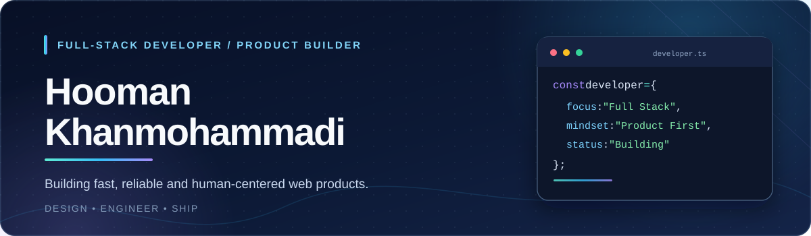

<div align="center">



<br />

<a href="https://pishansoft.ir"></a>
<a href="https://github.com/HoomanKhan53?tab=repositories"></a>

**Thoughtful software · Clean architecture · Better user experiences**

</div>

---

### 👋 About me

I'm **Hooman Khanmohammadi**, a full-stack developer and product builder working across modern web applications, e-commerce experiences, and interactive platforms.

I enjoy bringing **product thinking** and **engineering discipline** together — from an intuitive interface to the systems that power it.

- 🧩 **Focus:** Full-stack development, scalable application design, and thoughtful UX
- ⚡ **Approach:** Build for performance, maintainability, and real-world use
- 🛠️ **Interests:** Commerce platforms, interactive products, and developer-friendly tooling
- 🌐 **Website:** [PishanSoft](https://pishansoft.ir)

### 🧰 Technology stack

**Backend & data**


**Frontend & experience**


**Workflow**


### 🚀 What I build

| Area | What I care about |
| :--- | :--- |
| 🛍️ **E-commerce & web platforms** | Fast storefronts, clear customer journeys, reliable back-office workflows |
| 🎮 **Interactive applications** | Consistent game and application state, engaging experiences, dependable systems |
| 🧱 **Full-stack product engineering** | Clean APIs, maintainable architecture, and interfaces that feel effortless |

> I believe the best software is not only functional — it's **simple to use, resilient in production, and built to evolve**.

### ✨ Engineering principles

```text
01  User experience is a feature.
02  Performance is part of the design.
03  Simplicity beats unnecessary complexity.
04  Good products are continuously improved.
```

### 🤝 Let's connect

I enjoy discussing ambitious web products, architecture, product design, and interesting technical challenges.

**Explore:** [My GitHub](https://github.com/HoomanKhan53) · [PishanSoft](https://pishansoft.ir)

<div align="center">
  <sub>Designed with care • Hooman Khanmohammadi</sub>
</div>
